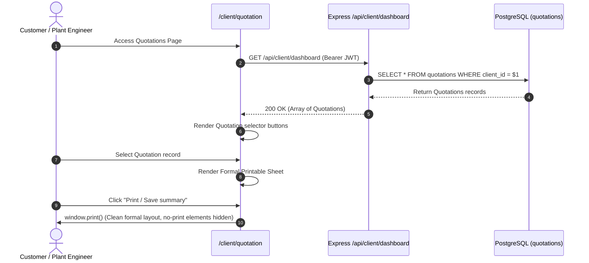
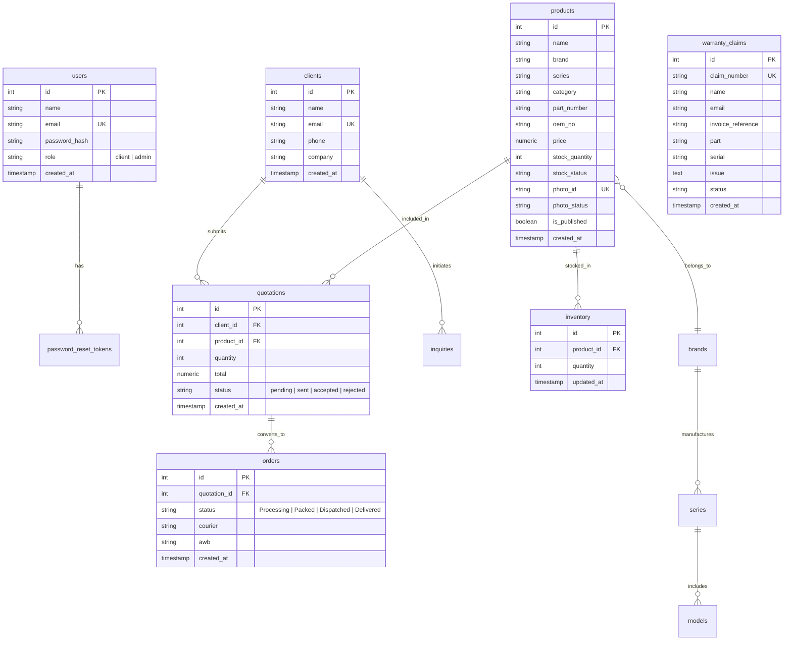

# Efforts Engineers — Portal Functionality Specification Document

**Document Reference:** `SPEC-PORTAL-v2.4`  
**System Name:** Efforts Engineers Dual-Role Industrial Commerce & Operations Portal  
**Target Release:** v2.4.0 Production Build  
**Compliance Standard:** ISO 9001:2015 Industrial Traceability · GSTIN/IEC Export Mandate  
**Classification:** Technical & Functional Architecture Specification  
**Primary Tech Stack:** Node.js 22 (ESM) · Express 5 · PostgreSQL 16 · Next.js 16 (App Router) · React 18  

---

## 1. Executive Summary & Purpose

The **Efforts Engineers Portal** represents the centralized digital backbone of **effortsengineers.in**, modernizing the organization's industrial compressor spares distribution across domestic Indian markets and 29+ international export destinations.

The portal is architected with a **Dual-Role Model**:
1. **Customer (Client) Portal (`/client/*`):** A self-service technical commerce desk for plant maintenance engineers, reefer fleet operators, and industrial procurement officers to browse inventory, configure multi-item RFQs, generate formal printable quotations (with HSN, GSTIN, and IEC credentials), track consignment dispatches in real-time, and submit warranty claims.
2. **Admin Operations Portal (`/admin/*`):** A command center for Efforts Engineers sales engineers, warehouse leads, and logistics managers to manage catalog master data, control live warehouse stock quantities, review and approve commercial quotations, dispatch consignments with courier AWB tracking, and monitor demand forecasting.

```mermaid
graph TD
    subgraph Public Domain
        PUB[Public Catalog / Home] --> REG[Register Account /auth/register]
        PUB --> LOG[Sign In /auth/login]
        PUB --> DRAWER[Quote Builder Drawer]
    end

    subgraph Auth & Security Tier
        REG --> AUTH[JWT Auth & Rate Limiter]
        LOG --> AUTH
        AUTH --> RBAC{Role Validation}
    end

    subgraph Client Portal [/client/*]
        RBAC -->|role: client| CDASH[Client Dashboard /client/dashboard]
        CDASH --> CQUOTE[Printable Quotations /client/quotation]
        CDASH --> CORD[Consignment Tracking /client/orders]
        CDASH --> CCAT[Live Stock Catalog /client/catalog]
        CDASH --> CWARN[Warranty Claims /warranty]
    end

    subgraph Admin Portal [/admin/*]
        RBAC -->|role: admin| APROD[Product & Photo Master /admin/dashboard]
        APROD --> AINV[Stock & Inventory /admin/inventory]
        APROD --> AQUOTE[RFQ Review & Approval /admin/quotations]
        APROD --> AORD[Fulfillment & Logistics /admin/orders]
        APROD --> AFORE[Demand Forecasting /admin/forecasting]
    end

    subgraph Backend & DB Tier
        REST[Express 5 REST API] --> PG[(PostgreSQL 16 DB)]
        CDASH -.-> REST
        APROD -.-> REST
    end
```

---

## 2. System Architecture & Tech Stack

### 2.1 Technology Standards
| Component | Technology | Version | Purpose |
| :--- | :--- | :--- | :--- |
| **Frontend Framework** | Next.js (App Router, Turbopack) | `16.0+` | Server-side rendering, static optimization, dynamic portal routing |
| **UI Library** | React (Hooks, Context API) | `18.3+` | State management (`AuthContext`, `QuoteContext`), component lifecycle |
| **Styling & Theme** | Industrial Amocon Theme (`globals.css`) | `v2.4` | High-contrast technical UI: Navy (`#0f172a`), Ocean Blue (`#0284c7`), Ice Slate (`#f8fafc`) |
| **Backend Runtime** | Node.js (ECMAScript Modules) | `22.x LTS` | Native ESM (`"type": "module"`), async/await, crypto utilities |
| **Web Server Framework** | Express | `^5.2.1` | Native promise rejection handling, modular route routers, middleware |
| **Database** | PostgreSQL | `15/16` | Relational integrity, foreign key cascades, transaction pooling via `pg` |
| **API Client** | Axios | `^1.7.0` | Centralized interceptor, bearer token injection, automated 401 redirect |
| **File Uploads** | Multer | `^1.4.5` | Multipart form handling for photo master images & warranty proof |
| **Security Utilities** | `bcryptjs`, `crypto`, `helmet`, `cors` | Latest | Salt hashing (10 rounds), timing-safe comparisons, HTTP headers |

### 2.2 Network & Communication Protocol
- All frontend portal communication routes through the centralized Axios client (`lib/axiosClient.js`).
- Base URL is environment-driven: `process.env.NEXT_PUBLIC_API_URL` (local: `http://localhost:5000/api`, production: `https://api.effortsengineers.in/api`).
- Standard authorization header injected on every request:
  ```http
  Authorization: Bearer <signed_jwt_token>
  ```
- 401 Unauthorized responses dispatch a custom DOM event `ee:session-expired`, prompting `AuthContext` to clear user state and redirect to `/auth/login`.

---

## 3. Security, Authentication & Role-Based Access Control (RBAC)

### 3.1 User Personas & Permissions
The portal enforces strict separation between user privilege tiers:

| Persona | Primary Stakeholders | Granted Scope & Routes |
| :--- | :--- | :--- |
| **Client (`client`)** | Plant Engineers, Purchase Managers, Fleet Operators | - Access `/client/*` (`/dashboard`, `/quotation`, `/orders`, `/catalog`)<br>- Submit RFQs, view self quotations & linked orders<br>- Generate printable formal quotation sheets<br>- Submit warranty claims (`/warranty`)<br>- Restricted from accessing any `/admin/*` routes or modifying other clients' data |
| **Admin (`admin`)** | Sales Engineers, Warehouse Admins, Logistics Leads | - Full access to `/admin/*` (`/dashboard`, `/inventory`, `/quotations`, `/orders`, `/forecasting`)<br>- Create, update, publish, and delete catalog products & photo master records<br>- Update warehouse stock quantities<br>- Review client RFQs, apply commercial pricing, and approve/send quotations<br>- Update consignment statuses and courier AWB numbers |

### 3.2 Authentication & Token Architecture
1. **Registration (`POST /api/auth/register`):**
   - Requires: `name`, `email`, `password`.
   - Validates email format, enforces password strength.
   - Hashes password using `bcryptjs.hash(password, 10)`.
   - Assigns default role `'client'`.
   - Employs rate-limiting: Maximum 5 registrations per 15-minute window per IP.
2. **Login (`POST /api/auth/login`):**
   - Accepts identifier (`email` or `username`) and `password`.
   - Password verification utilizes `crypto.timingSafeEqual` over pre-computed buffers to eliminate side-channel timing attack vectors.
   - Generates signed JSON Web Token (JWT) with payload:
     ```json
     {
       "id": 14,
       "email": "purchasing@coldstorage.com",
       "role": "client",
       "iat": 1731792000,
       "exp": 1731878400
     }
     ```
   - Rate limiting: Maximum 10 failed attempts per 15-minute window per IP.
3. **Session Verification (`GET /api/auth/profile`):**
   - Protected route verifying current Bearer token validity and returning sanitized user profile: `{ id, name, username, email, role }`.
4. **Route Guard Enforcement:**
   - **Client Routes:** Protected by `<ClientProtectedRoute>` component wrapping `ClientLayout`. Redirects unauthenticated users to `/auth/login`.
   - **Admin Routes:** Protected by `<ProtectedRoute role="admin">` component wrapping `AdminLayout`. Non-admin sessions receive an immediate 403 Access Denied or redirect.
   - **Backend API Middleware:** `requireAuth` validates token signature; `requireRole('admin')` validates `req.user.role === 'admin'`.

### 3.3 Search Engine & Public Crawler Isolation
To prevent sensitive industrial customer pricing, stock quantities, and consignment tracking numbers from indexing on search engines:
- `robots.txt` / `app/robots.js` explicitly blocks all `/client/`, `/admin/`, and `/auth/` routes:
  ```txt
  User-agent: *
  Disallow: /client/
  Disallow: /admin/
  Disallow: /auth/
  ```
- Every portal page includes `X-Robots-Tag: noindex, nofollow` HTTP headers and HTML metadata tags `<meta name="robots" content="noindex, nofollow" />`.

---

## 4. Customer (Client) Portal Specification (`/client/*`)

### 4.1 Client Layout & Shell (`components/ClientLayout.js`)
- Enclosed inside `<ClientProtectedRoute>`.
- **Navigation Sidebar (`portal-sidebar-client`):**
  - Brand header: `"Customer Workspace · Client Portal"`.
  - Active route highlighting.
  - Links:
    - `📊 Overview & KPIs` (`/client/dashboard`)
    - `📄 Quotation Records` (`/client/quotation`)
    - `🚚 Orders` (`/client/orders`)
    - `📦 Browse Catalog` (`/client/catalog`)
    - `🛡️ Warranty Claims` (`/warranty`)
- **Main Portal Canvas:** Fluid responsive container with high-contrast slate surfaces, clean borders, and clear hierarchical headings.

### 4.2 Customer Dashboard (`/client/dashboard`)
The command dashboard for authenticated customers provides real-time situational awareness of active procurement operations.

#### Functional Requirements:
1. **User Welcome Banner:** Displays `"Welcome back, {user.name}"` with plant engineer subtitle and account summary instructions.
2. **KPI Overview Grid:**
   - **Quotation Records Card:** Total count of active quotation records linked to the customer's account.
   - **Order Records Card:** Total count of order records currently linked to the account.
3. **Action Strip:**
   - `+ Request New Spares Quotation`: Immediately opens the persistent `QuoteBuilderDrawer`.
   - `📄 View Quotations`: Navigates to `/client/quotation`.
   - `🚚 View Orders`: Navigates to `/client/orders`.
   - `🛡️ Submit Warranty Claim`: Navigates to `/warranty`.
4. **Recent Quotations Table:**
   - Columns: `Quote Ref`, `Requested Date`, `Items Specification`, `Quoted Total`, `Status`, `Action`.
   - Displays real-time status badges:
     - `badge-in-stock` (Approved / Accepted)
     - `badge-low-stock` (Pending / Review)
   - "View summary" CTA loads the record into the printable quote sheet view.
5. **Recent Orders Consignment Table:**
   - Columns: `Order Ref`, `Quotation Ref`, `Order Date`, `Status`.
   - Status badge: `badge-in-stock` for "Delivered", `badge-order` for "Processing" / "Dispatched".

### 4.3 Formal Printable Quotations (`/client/quotation`)
Designed to eliminate manual quoting delays by producing standardized, audit-ready commercial quotation sheets directly in the browser.



#### Detailed Sheet Specifications:
- **Quotation Tab Strip:** Top scrollable selector allowing one-click switching between recent quote records.
- **Printable Formal Sheet (`.printable-quote-sheet`):**
  - **Company Letterhead:**
    - Corporate Entity: Efforts Engineers (Established in Pune, 1986).
    - Registered Office: Shop No. 10 & 11, Shirole Park, Vetal Baba Chowk, Senapati Bapat Road, Shivajinagar, Pune, Maharashtra 411016, India.
    - Statutory Registrations: GSTIN, IEC Code (Import Export Code for cross-border shipments), ISO 9001:2015 Traceability Standard.
  - **Quotation Metadata:** Record Reference (`#EE-QT-{id}`), Creation Date, Authenticated Customer Name and Email.
  - **Itemized Commercial Table:**
    - Part Number / Product Reference ID
    - Part Description & Brand Make (Grasso, Bitzer, Kirloskar, Carrier, Sabroe, etc.)
    - Quantity requested
    - Recorded Subtotal / Total in INR (`₹`)
  - **Statutory Terms & Disclaimers:**
    - Explicit note: Informational summary of active portal records.
    - Official commercial commitment subject to final confirmation by Efforts Engineers Pune sales desk.
    - Applicable taxes: 18% GST for domestic consignments; zero-rated export with LUT for overseas shipments.
  - **Print & PDF Support:**
    - `window.print()` invocation.
    - Dedicated `@media print` rules hide sidebars, navigation bars, buttons, and footers (`.no-print`), ensuring strict letter-size PDF pagination.

### 4.4 Orders & Consignment Logistics Tracking (`/client/orders`)
Provides end-to-end transparency over ordered compressor spares throughout warehouse packing and air cargo dispatch.

#### Functional Specifications:
- Fetches all orders belonging to the authenticated client via `GET /api/client/dashboard`.
- **Order Card Attributes:**
  - Order Reference Number: `EE-ORD-{id}`.
  - Order Status Badge: `Processing`, `Packed (VCI Ready)`, `Dispatched (Air)`, `Delivered`.
  - Linked Quotation Cross-Reference (`Quotation record #{quotation_id}`).
  - Order Date formatted to localized client standards.
  - Consignment Logistics details (when provided): Carrier Name (e.g., Blue Dart Air, DHL Priority, DTDC), Air Waybill (AWB) consignment tracking code.
- **Zero-State Handling:** Clear fallback notice with instant "Contact our team" button when no orders are linked to the account.

### 4.5 Client Spare Parts Catalog (`/client/catalog`)
Provides authenticated customers an interactive view of stock availability with immediate RFQ building capabilities.

#### Functional Specifications:
- **Server Pagination:** 24 products per page (`LIMIT 24 OFFSET {page - 1} * 24`).
- **Real-Time Stock Status Badges:**
  - `🟢 In Stock (24-48h Dispatch)`: Readily available in Pune warehouse.
  - `🟡 Low Stock`: Fast-moving part with limited shelf quantity.
  - `🔵 Sourced to Order`: Available through certified manufacturer network.
- **Search & Filter Controls:**
  - Debounced text search (300ms) matching name, brand, series, part number, and OEM reference.
  - Brand filter dropdown: All, Grasso, Bitzer, Kirloskar, Carrier, Sabroe, Bock, Daikin, Mycom.
- **Direct Quote Integration:** Each product card includes an **"+ Add to Quote"** button that directly feeds into the persistent `QuoteContext`.

### 4.6 Persistent Quotation Builder Drawer (`components/QuoteBuilderDrawer.js`)
An interactive slide-out drawer accessible throughout public and client pages.

#### Features & Data Pipeline:
- **Slide-Out Drawer Interface:** Positioned fixed right, toggled by `QuoteContext.isDrawerOpen`.
- **Item Controls:** Real-time quantity increment/decrement (`+` / `-`), item removal, and estimated subtotal recalculation.
- **Commercial Inquiry Form:**
  - Customer Name, Email, Phone, Company Name.
  - Equipment Urgency Selector:
    - `Standard`: Routine replenishment.
    - `Shutdown / Planned Overhaul`: Scheduled downtime.
    - `Breakdown / Urgent`: Critical plant stoppage (triggers expedited response priority).
  - Custom engineering notes / compressor model number entry.
- **Submission Workflow:**
  - Posts payload to `POST /api/quotation` or `POST /api/client/request-quotation`.
  - Generates automated RFQ reference: `EE-QT-{id}`.
  - Triggers email notification via `nodemailer` / `sendEmailNotification` to sales engineering desk and customer.

---

## 5. Admin Operations Portal Specification (`/admin/*`)

### 5.1 Admin Shell & Layout (`components/AdminLayout.js`)
- Enclosed inside `<ProtectedRoute role="admin">`.
- **Navigation Sidebar (`portal-sidebar-admin`):**
  - Operations Console title.
  - Navigation links:
    - `📦 Products & Photo Master` (`/admin/dashboard` / `/admin/products`)
    - `📊 Stock & Inventory` (`/admin/inventory`)
    - `📋 Quotations Approval` (`/admin/quotations`)
    - `🚚 Order Fulfillment` (`/admin/orders`)
    - `📈 Predictive Analytics` (`/admin/forecasting`)

### 5.2 Product & Photo Master Manager (`/admin/ProductsManager.js`)
A comprehensive master catalog editor aligning 1:1 with the master parts photo inventory (`Efforts_Engineers_Parts_Photo_Master_Sheet.xlsx`).

```mermaid
flowchart TD
    ADMIN[Admin / Operations Engineer] -->|Navigate| APM[/admin/dashboard - ProductsManager]
    APM -->|Search / Filter| API_LIST[GET /api/admin/products]
    API_LIST --> DB_PROD[(products table)]

    ADMIN -->|Upload Image| API_UPLOAD[POST /api/admin/products/photo]
    API_UPLOAD --> DISK[Store in /images/ & generate URL]

    ADMIN -->|Submit Form| API_MUTATE{Action}
    API_MUTATE -->|Create| API_POST[POST /api/admin/products]
    API_MUTATE -->|Update| API_PUT[PUT /api/admin/products/:id]
    API_MUTATE -->|Delete| API_DEL[DELETE /api/admin/products/:id]

    API_POST --> DB_PROD
    API_PUT --> DB_PROD
    API_DEL --> DB_PROD
```

#### Field Schema Matrix:
| Field Identifier | UI Label | Control Type | Options / Constraints |
| :--- | :--- | :--- | :--- |
| `name` | Part Name | Text Input | Required, min 3 characters |
| `brand` | Brand / Manufacturer | Select / Input | Grasso, Bitzer, Kirloskar, Carrier, Sabroe, Bock, Daikin, Mycom |
| `series` | Compressor Series | Select / Input | Dynamically linked to selected brand |
| `category` | Part Category | Select / Input | Liner, Piston, Ring, Valve, Gasket, Bush, Shaft Seal, Connecting Rod |
| `part_number` | Part Number | Text Input | Internal EE reference code |
| `oem_no` | OEM Number | Text Input | Manufacturer original part number |
| `compatible_models` | Compatible Models | Text Input | Comma-delimited compressor models (e.g., `RC11, RC12`) |
| `material_size` | Material / Dimensions | Text Input | Material grade, bore diameter, tolerance |
| `photo_id` | Photo ID Code | Text Input | Unique photo identifier (e.g., `GRA-LIN-001`) |
| `photo_source` | Photo Source | Select | `Own photo`, `Supplier photo`, `Customer photo` |
| `photo_status` | Photo Status | Select | `To Shoot`, `Shot`, `Edited`, `Uploaded`, `Not Applicable` |
| `photo_view` | Photo Angle | Select | `Front`, `Angled`, `Top`, `Set / Kit`, `With ruler` |
| `stock_status` | Stock Status | Select | `In Stock`, `On Order`, `Enquire` |
| `stock_quantity` | Warehouse Quantity | Number Input | Non-negative integer (default `0`) |
| `price` | Base Unit Price (INR) | Number Input | Decimal numeric |
| `is_published` | Catalog Published | Checkbox | Controls public catalog visibility |
| `remarks` | Engineering Remarks | Textarea | Internal notes, metallurgical observations |

### 5.3 Stock & Inventory Control (`/admin/inventory`)
Enables rapid warehouse auditing and stock balance adjustments.

#### Functional Specifications:
- Fetches inventory joined with catalog product metadata via `GET /api/inventory`.
- Search across SKU, part number, and part name.
- Filter by Brand.
- **Inline Stock Stepper:**
  - One-click `+` / `-` buttons instantly increment/decrement physical stock.
  - Invokes `PUT /api/inventory/:id` with payload `{ quantity }`.
  - Disables action during pending API call to prevent race conditions.
  - Updates PostgreSQL `inventory` table with `updated_at = NOW()`.

### 5.4 Quotation Review & Commercial Desk (`/admin/quotations`)
The commercial engine where sales engineers convert raw client inquiries into formalized commercial quotations.

#### Functional Specifications:
- **Inbound Inquiries Queue:** Lists all RFQs received from public and client portals.
- **Filter by Status:** `All`, `pending`, `sent`, `accepted`, `rejected`, `expired`.
- **Quotation Details Modal:**
  - View full client submission: Client Name, Company Name, Contact Phone, Email, Equipment Urgency, Notes.
  - Part Requested & Quantity.
- **Commercial Pricing Tool:**
  - Admin enters approved unit price or adjusted total.
  - Admin clicks "Approve & Mark Sent".
  - Invokes `PUT /api/quotation/:id/status` with payload `{ status: 'sent', total: updatedTotal }`.
  - Updates quote status; immediately reflects in customer's `/client/quotation` tab.

### 5.5 Order Fulfillment & Consignment Management (`/admin/orders`)
The operational workflow for tracking physical packing, dispatch, and delivery of industrial spare parts.

#### Functional Specifications:
- Lists all active orders fetched via `GET /api/orders`.
- **Fulfillment Lifecycle States:**
  1. `Processing`: Order received, warehouse pick list generated.
  2. `Packed (VCI Ready)`: Parts coated with Volatile Corrosion Inhibitor (VCI) paper and sealed in wooden crates for export/transit.
  3. `Dispatched (Air / Road)`: Handed over to logistics carrier; AWB number issued.
  4. `Delivered`: Consignment delivered to customer plant site.
- **Logistics Courier & AWB Assignment:**
  - Admin records carrier partner (e.g., `Blue Dart Air`, `DHL Priority`, `DTDC Express`).
  - Admin enters Air Waybill tracking code (`BLUEDART-8829104`, `DHL-44029104`).
  - Live status update persisted via `PUT /api/orders/:id`.

### 5.6 Predictive Analytics & Demand Forecasting (`/admin/forecasting`)
- **Objective:** Prevent stock-outs of critical breakdown spares (such as Grasso RC11 liners, Bitzer valve plates, and Kirloskar connecting rod bearings).
- **Forecasting Algorithm:**
  - Analyzes 30/60/90-day moving average of quotation requests and order conversions.
  - Integrates with `Chart.js` (`react-chartjs-2`) for visual trend rendering.
  - Calculates reorder triggers when warehouse stock drops below anticipated 14-day lead time consumption.

---

## 6. Database Schema & Relational Integrity

The portal functionality relies on a normalized PostgreSQL schema ensuring full auditability and referential integrity.



---

## 7. API Endpoint Contracts & Integration Matrix

### 7.1 Authentication Endpoints (`/api/auth`)
| Method | Endpoint | Access | Request Body | Response Codes | Description |
| :--- | :--- | :--- | :--- | :--- | :--- |
| `POST` | `/api/auth/register` | Public | `{ name, email, password }` | `201`, `400`, `429` | Register new customer portal user |
| `POST` | `/api/auth/login` | Public | `{ identifier, password }` | `200`, `401`, `429` | Login and receive signed JWT token |
| `GET` | `/api/auth/profile` | Auth User | Header: `Bearer <token>` | `200`, `401` | Retrieve authenticated profile |
| `POST` | `/api/auth/logout` | Auth User | Header: `Bearer <token>` | `200` | Invalidate client session |

### 7.2 Customer Portal Endpoints (`/api/client`)
| Method | Endpoint | Access | Query / Body Params | Response Structure | Purpose |
| :--- | :--- | :--- | :--- | :--- | :--- |
| `GET` | `/api/client/dashboard` | Client | Header: `Bearer <token>` | `{ quotations: [...], orders: [...] }` | Load customer dashboard KPIs & history |
| `POST` | `/api/client/request-quotation` | Client | `{ customer_name, product_id, quantity, notes, urgency }` | `{ id, quoteId, status, notification }` | Submit multi-item RFQ from portal |

### 7.3 Quotation & Order Endpoints
| Method | Endpoint | Access | Parameters / Body | Purpose |
| :--- | :--- | :--- | :--- | :--- |
| `GET` | `/api/quotation` | Admin | Filter: `status` | Retrieve inbound RFQs for admin review |
| `POST` | `/api/quotation` | Public / Client | `{ customer_id, product_id, quantity, price }` | Submit quotation request |
| `PUT` | `/api/quotation/:id/status`| Admin | `{ status, total }` | Update quotation status and finalize pricing |
| `GET` | `/api/orders` | Admin / Auth | — | List all fulfillment orders |
| `POST` | `/api/orders` | Auth User | `{ customer_id, product_id, quantity }` | Convert approved quotation to order |
| `PUT` | `/api/orders/:id` | Admin | `{ status, quantity, courier, awb }` | Update order fulfillment and AWB tracking |

### 7.4 Inventory & Admin Product Endpoints
| Method | Endpoint | Access | Parameters / Body | Purpose |
| :--- | :--- | :--- | :--- | :--- |
| `GET` | `/api/inventory` | Admin | Search / Brand filter | List physical inventory stock levels |
| `PUT` | `/api/inventory/:id` | Admin | `{ quantity }` | Adjust stock count for an inventory record |
| `GET` | `/api/admin/products`| Admin | `page`, `photoId`, `brand`, `category` | Paginated product and photo master records |
| `POST` | `/api/admin/products`| Admin | Full product metadata payload | Create new catalog item |
| `POST` | `/api/admin/products/photo` | Admin | Multipart form `image` | Upload product photo to `/images` |
| `PUT` | `/api/admin/products/:id` | Admin | Product metadata payload | Update product details |
| `DELETE`| `/api/admin/products/:id` | Admin | `id` path param | Remove product record |

---

## 8. Non-Functional Requirements (NFRs)

### 8.1 Performance & Scalability
- **API Latency:** 95% of portal API queries (`/api/client/dashboard`, `/api/inventory`, `/api/orders`) must respond within `< 200ms` under normal load.
- **Frontend Optimization:** All portal pages prerender with static shell optimization using Next.js 16 and Turbopack.
- **Database Efficiency:** Connection pooling via `pg.Pool` with connection reuse and indexed lookups on `client_id`, `email`, `photo_id`, and `order_id`.

### 8.2 Security & Data Isolation
- **Tenant Segregation:** Client queries strictly filter by authenticated user session (`WHERE client_id = $1` or `WHERE email = $1`). Clients cannot view or infer data from other accounts.
- **SQL Injection Defense:** All queries without exception use parameterized inputs (`$1, $2, ...`). String interpolation inside SQL statements is strictly prohibited.
- **Cross-Site Scripting (XSS):** React auto-escaping combined with Helmet security headers (`X-Frame-Options: DENY`, `X-Content-Type-Options: nosniff`).

### 8.3 Reliability & Auditability
- **ISO 9001:2015 Traceability:** Every formal quote and order record permanently retains OEM part number, brand make, revision timestamp, and authorizing admin ID.
- **Graceful Error Handling:** All frontend portal tables implement dedicated loading skeletons, empty state prompts, and accessible error banners (`role="alert"`).

---

## 9. Verification & Traceability Matrix

| Requirement ID | Module | Verification Method | Automated Test Suite |
| :--- | :--- | :--- | :--- |
| **REQ-AUTH-01** | User Registration & Role Assignment | Backend Unit Test | `tests/auth.test.js` (Verify client role & bcrypt hash) |
| **REQ-AUTH-02** | Constant-Time Password Check | Security Verification | `tests/auth.test.js` (`timingSafeEqual` validation) |
| **REQ-CP-01** | Client Dashboard KPI Loading | Integration Test | `tests/client.test.js` (`GET /api/client/dashboard`) |
| **REQ-CP-02** | Formal Quotation Sheet Printing | Frontend Component QA | Verification in `@media print` layout test |
| **REQ-CP-03** | Consignment AWB Tracking | End-to-End Test | Order tracking state validation (`orders.test.js`) |
| **REQ-AP-01** | Photo Master Image Upload | Multipart Test | `tests/admin.products.test.js` (Multer file processing) |
| **REQ-AP-02** | Live Stock Quantity Stepper | Concurrency Test | `tests/inventory.test.js` (`PUT /api/inventory/:id`) |
| **REQ-AP-03** | Quotation Commercial Pricing | Approval Workflow Test| `tests/quotations.test.js` (`PUT /api/quotation/:id/status`)|

---

## 10. Conclusion & Maintenance Sign-Off

This specification serves as the formal baseline for all engineering enhancements to the **Efforts Engineers Customer and Admin Portals**. Any modifications to API contracts, authentication mechanisms, database schemas, or statutory quotation formats must be submitted as a revision to this document (`SPEC-PORTAL-v2.x`) and approved by the lead systems architect.
